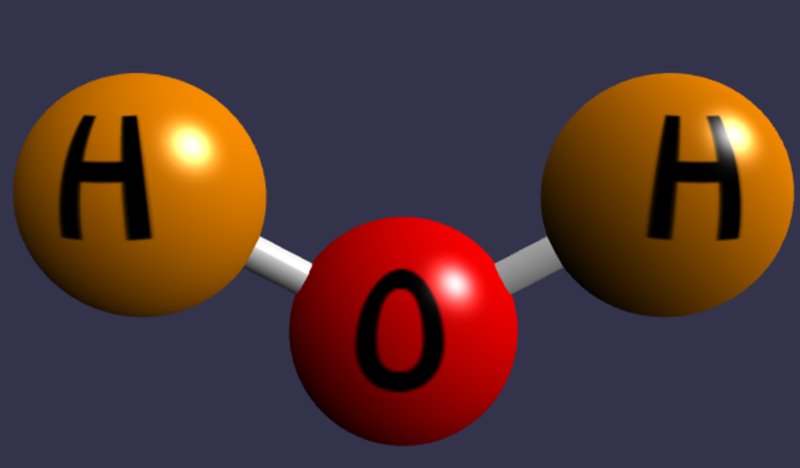
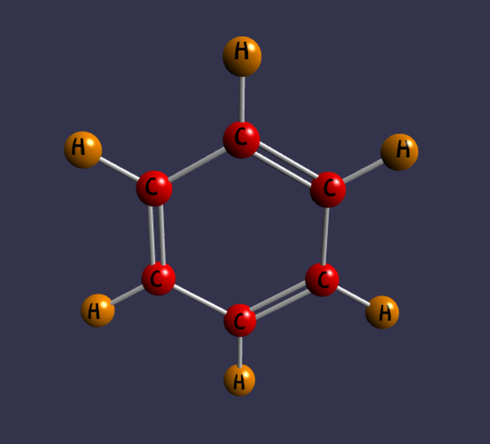
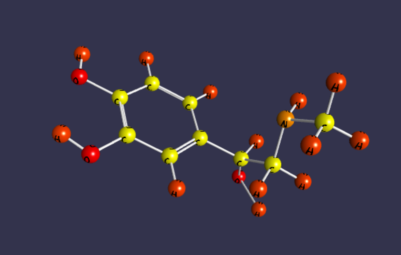

# Molecule Creator

`MoleculeCreator` is the built-in `SceneCreator` subclass that turns `ChemicalData`
into a 3D scene. It is used automatically when you pass `ChemicalData` as the
`SceneData` parameter of `BabylonCanvas`.

## How It Works

The `CreateAsync` method performs these steps:

1. **Calculate the bounding box** — determines the molecule size to set the camera
   distance.
2. **Create the engine and scene** — standard Babylon.js setup with antialiasing.
3. **Create the camera** — an `ArcRotateCamera` positioned at a distance
   proportional to the molecule size (`absolutMax * 3.6`).
4. **Create a hemispheric light** — directional light at intensity 0.98.
5. **Assign colors** — each unique element name gets a color from `ColorPalette`.
6. **Create materials with textures** — for each element, a `DynamicTexture` is
   created with the element symbol rendered as bold monospace text.
7. **Center the molecule** — calls `MoveCenterToZero()` so the molecule rotates
   around its center.
8. **Create atom spheres** — one sphere per atom, scaled by `DistanceScale` (2.0).
9. **Create bond tubes** — one or more tubes per bond, depending on bond type.
10. **Start the render loop** — with auto-rotate if enabled.

## Distance Scale

All atom coordinates are multiplied by `DistanceScale` (default `2.0`) to make the
molecule visible at a reasonable size. This is a public property on
`MoleculeCreator`:

```csharp
creator.DistanceScale = 3.0; // larger molecule
```

## Bond Rendering

### Single Bond

One tube from atom A to atom B with radius 0.075.

### Double Bond

Two parallel tubes offset from the center line. The offset direction is calculated
from the bond angle relative to the Y axis.

### Triple Bond

One central tube plus two offset tubes (same geometry as a double bond, but with
a wider line distance of 0.1).

## Camera Distance

The camera radius is set to `absolutMax * 3.6`, where `absolutMax` is the larger
of the X or Y extent of the molecule bounding box. This ensures the molecule fits
in the viewport regardless of its size.

## Error Handling

If `ChemicalData.ShowErrorText` is `true` and `ErrorText` is not empty, the
`BabylonCanvasBase` draws the error text on the canvas instead of calling
`MoleculeCreator`. If there are no atoms, "Nothing to Draw" is displayed.

## Customizing Molecule Rendering

To customize how molecules are rendered, subclass `SceneCreator` (or
`MoleculeCreator`) and override `CreateAsync`. Then create a custom canvas that
uses your creator. See [Custom Scene](../getting-started/custom-scene.md).

## Example Molecules

The demo application renders several molecules from `ChemicalData`:

### Water (H<sub>2</sub>O)



### Benzene (C<sub>6</sub>H<sub>6</sub>)



### Epinephrine (C<sub>9</sub>H<sub>13</sub>NO<sub>3</sub>)


