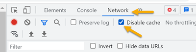

# Installation

Babylon.Blazor is a single NuGet package:

```bash
dotnet add package Babylon.Blazor
```

You need .NET 10.0 or later.

## Add Babylon.js Script References

Add the Babylon.js library and the interop script to your `App.razor` or `index.html`:

```html
<body>
    <Routes />
    <script src="https://preview.babylonjs.com/babylon.js"></script>
    <script src="https://preview.babylonjs.com/loaders/babylonjs.loaders.min.js"></script>
    <script type="module" src="_content/Babylon.Blazor/babylonInterop.js"></script>
    <script src="_framework/blazor.web.js"></script>
</body>
```

The three Babylon-specific scripts are:

| Script | Purpose |
| --- | --- |
| `babylon.js` | The core Babylon.js engine |
| `babylonjs.loaders.min.js` | File format loaders (optional, needed for model loading) |
| `babylonInterop.js` | The JS bridge between C# and Babylon.js provided by the NuGet package |

## Register the Instance Creator in DI

The library needs an `InstanceCreatorBase` registered in dependency injection.
The registration differs between server-side and client-side hosting.

### Server-side (prerendering / SSR)

```csharp
builder.Services.AddTransient<InstanceCreatorBase>(
    sp => new InstanceCreatorAsyncMode(sp.GetService<IJSRuntime>()));
```

> **Note:** Server-side mode only supports `IJSObjectReference` (async mode).

### Client-side (WebAssembly)

```csharp
builder.Services.AddTransient<InstanceCreatorBase>(
    sp => new InstanceCreator(sp.GetService<IJSRuntime>()));
```

## Add the Using Directive

Add to your `_Imports.razor`:

```razor
@using Babylon.Blazor
```

This step is optional but lets you use `BabylonCanvas` and `ChemicalData` without
fully qualified names.

## What You Get

The package contains:

| Part | What the package provides |
| --- | --- |
| `BabylonCanvas` | Razor component that renders a `<canvas>` and manages the Babylon.js lifecycle |
| `ChemicalData` | Data model for atoms and bonds, rendered automatically as a 3D molecule |
| `SceneCreator` | Base class for building custom 3D scenes |
| Babylon API wrappers | C# wrappers for `Engine`, `Scene`, `Mesh`, `Material`, `Sprite`, `ArcRotateCamera`, lights |
| `ChemFormulaViewer` | Razor component that renders chemical formulas with subscript numbers |
| `babylonInterop.js` | JavaScript module that creates and controls Babylon.js objects |

## Dependencies

- `Microsoft.AspNetCore.Components.Web` (Blazor component support)
- `Microsoft.AspNetCore.Html.Abstractions` (HTML rendering for `ChemFormulaViewer`)

The package contains **no Babylon.js files**. You must reference Babylon.js
separately via CDN or local files, as shown above.

## Troubleshooting

If changes to JavaScript files don't appear after a rebuild, disable the browser
cache in developer tools and refresh the page:


