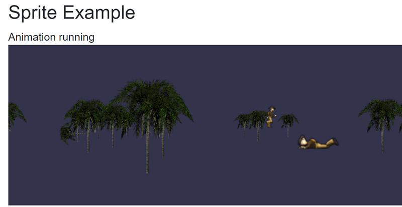
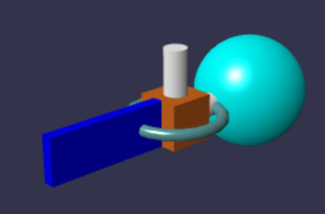
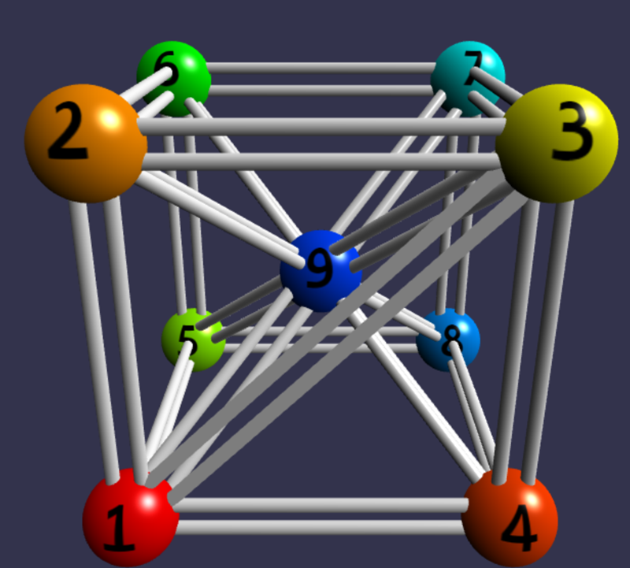
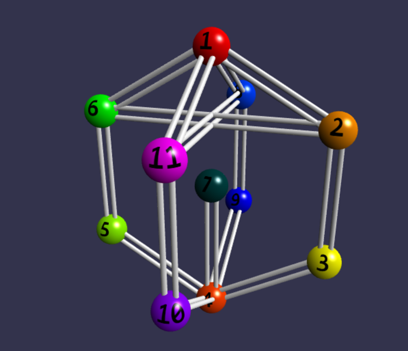

# Quick Start

You need three things to render a 3D scene:

1. The NuGet package installed and scripts referenced (see [Installation](installation.md)).
2. `InstanceCreatorBase` registered in DI.
3. A Razor page with a `BabylonCanvas` component and an `IData` object.

The fastest way to see something on screen is to pass a `ChemicalData` object —
it builds the entire scene (camera, lights, meshes, materials) automatically.
But `ChemicalData` is just one implementation of `IData`; you can render any 3D
scene by writing a custom `SceneCreator` (see [Custom Scene](custom-scene.md)).

## 1. Render a Scene with ChemicalData

`ChemicalData` holds a list of atoms (with 3D coordinates) and bonds. Build it
once during `OnInitializedAsync`:

```csharp
@using Babylon.Blazor
@using Babylon.Blazor.Chemical
@rendermode InteractiveAuto

<h1>Water</h1>

<p>Chemical formula of water is <ChemFormulaViewer FormulaText="H2O"/></p>

<div style="height: 600px;">
    <BabylonCanvas CanvasId="Canvas1" SceneData=@PanelData>
        <LoadingTemplate>
            <div>Loading...</div>
        </LoadingTemplate>
    </BabylonCanvas>
</div>

@code {
    ChemicalData PanelData { get; } = new ChemicalData();

    async Task InitDataAsync()
    {
        await Task.FromResult(1);

        PanelData.Atoms.Add(new AtomDescription() { Name = "O", X = 2.5369, Y = -0.1550, Z = 0.0000 });
        PanelData.Atoms.Add(new AtomDescription() { Name = "H", X = 3.0739, Y =  0.1550, Z = 0.0000 });
        PanelData.Atoms.Add(new AtomDescription() { Name = "H", X = 2.0000, Y =  0.1550, Z = 0.0000 });

        PanelData.Bonds.Add(new BondDescription(1, 2, BondDescription.BondType.Single));
        PanelData.Bonds.Add(new BondDescription(1, 3, BondDescription.BondType.Single));
    }

    protected override async Task OnInitializedAsync()
    {
        await InitDataAsync();
    }
}
```

## 2. What Happens Inside

When the component renders:

1. `BabylonCanvas` calls `InstanceCreatorBase.CreateBabylonAsync()` to get a
   `BabylonInstance` (the C# side of the Babylon.js engine).
2. The canvas detects that `SceneData` is `ChemicalData` and creates a
   `MoleculeCreator`.
3. `MoleculeCreator` builds the scene: camera, lights, spheres for atoms, tubes
   for bonds, and materials with element-name textures.
4. The render loop starts and the scene appears on screen.

## 3. Canvas Parameters

The `BabylonCanvas` component accepts these parameters:

| Parameter | Type | Default | Description |
| --- | --- | --- | --- |
| `CanvasId` | `string` | `"babylon-canvas"` | Unique HTML id for the `<canvas>` element |
| `SceneData` | `IData` | — | The data to visualize. Pass any `IData` implementation — `ChemicalData` for molecules, or your own class for custom scenes |
| `UseAutoRotate` | `bool` | `true` | Whether the camera auto-rotates around the target |
| `IdleRotationSpeed` | `double` | `1` | Speed of the auto-rotation |
| `LoadingTemplate` | `RenderFragment?` | `"Loading..."` | Custom content shown while the engine initializes |

## 4. Container Height

The `<canvas>` element fills its parent container. Set an explicit height on the
wrapping `<div>` so the canvas has room to render:

```html
<div style="height: 600px;">
    <BabylonCanvas CanvasId="Canvas1" SceneData=@PanelData />
</div>
```

## Bond Types

`BondDescription.BondType` supports three values:

| Value | Rendering |
| --- | --- |
| `Single` | One tube connecting the two atoms |
| `Double` | Two parallel tubes |
| `Triple` | One central tube plus two offset tubes |

## Error Display

If something goes wrong, `ChemicalData` can show an error message on the canvas
instead of a molecule:

```csharp
PanelData.ErrorText = "Failed to load molecule data";
PanelData.ShowErrorText = true;
```

## Beyond Molecules

`ChemicalData` is the quickest way to get a 3D scene running, but the library
is not limited to molecules. You can render spheres, boxes, cylinders, tori,
tubes, sprites, and custom materials in any combination.

To build your own scene, create a `SceneCreator` subclass and a custom canvas
component. See [Custom Scene](custom-scene.md) for a full walkthrough.

## Demo Output

The [SSR demo application](https://babylonblazorappnet80.azurewebsites.net) renders these scenes:

Water (H₂O)


Benzene (C₆H₆)


Epinephrine (C₉H₁₃NO₃)


Sprites



Custom scene (sphere + box)



Test scenes




