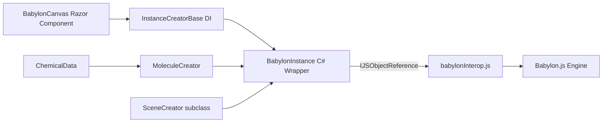

# Babylon.Blazor Developer Manual

Babylon.Blazor wraps the well-known 3D library [Babylon.js](https://www.babylonjs.com/)
into a Razor component you can use in a C# Blazor project. The library focuses on
chemical molecule visualization, but also exposes a general-purpose 3D API for
creating custom scenes with meshes, materials, sprites, and cameras.

## Where to Start

- New to the library? Read [Installation](getting-started/installation.md)
  and the [Quick Start](getting-started/quick-start.md).
- Want to draw your own 3D scene? See [Custom Scene](getting-started/custom-scene.md).
- Need to visualize a molecule? See
  [Chemical Data](chemical-visualization/chemical-data.md).
- Looking for specific types? See the
  [API Reference](api-reference/overview.md).

## Feature Overview

| Feature | Entry point | What it does | Docs |
| --- | --- | --- | --- |
| 3D Canvas | `BabylonCanvas` | Razor component that hosts a Babylon.js scene inside a Blazor page | [BabylonCanvas](core-concepts/babylon-canvas.md) |
| Molecule Viewer | `ChemicalData` | Describe atoms and bonds, the library renders the 3D molecule automatically | [Chemical Data](chemical-visualization/chemical-data.md) |
| Custom Scenes | `SceneCreator` | Subclass to build any 3D scene with spheres, boxes, cylinders, tori, tubes | [Custom Scene](getting-started/custom-scene.md) |
| Sprites | `SpriteManager`, `Sprite` | 2D sprites and sprite-sheet animations inside a 3D scene | [Sprites](3d-primitives/sprites.md) |
| Materials | `Material`, `DynamicTexture` | Colored and textured materials with diffuse/emissive properties | [Materials](3d-primitives/materials.md) |
| Camera | `ArcRotateCamera` | Orbit camera that rotates around a target with auto-rotate support | [API Reference](api-reference/overview.md) |
| Lights | `HemisphericLight`, `PointLight` | Scene lighting | [API Reference](api-reference/overview.md) |
| Chemical Formula | `ChemFormulaViewer` | Razor component that renders a chemical formula with subscript numbers | [API Reference](api-reference/overview.md) |
| Loading Indicator | `LoadingTemplate` | Customizable overlay shown while the Babylon engine initializes | [BabylonCanvas](core-concepts/babylon-canvas.md) |

## Architecture at a Glance

The library sits between your Blazor component and the Babylon.js JavaScript engine.
C# wrapper classes hold `IJSObjectReference` handles to JavaScript objects. All
communication happens through the `BabylonInstance` interop layer.

## Demo Applications

- [.NET 8.0 SSR Demo](https://babylonblazorappnet80.azurewebsites.net) — server-side prerendering
- [.NET 8.0 Wasm Demo](https://babylonblazorwasmnet80.azurewebsites.net) — WebAssembly
- [PubChem Viewer](https://pubchemviewer.azurewebsites.net) — chemical information from PubChem

## License

MIT — see the `LICENSE` file in the repository.
